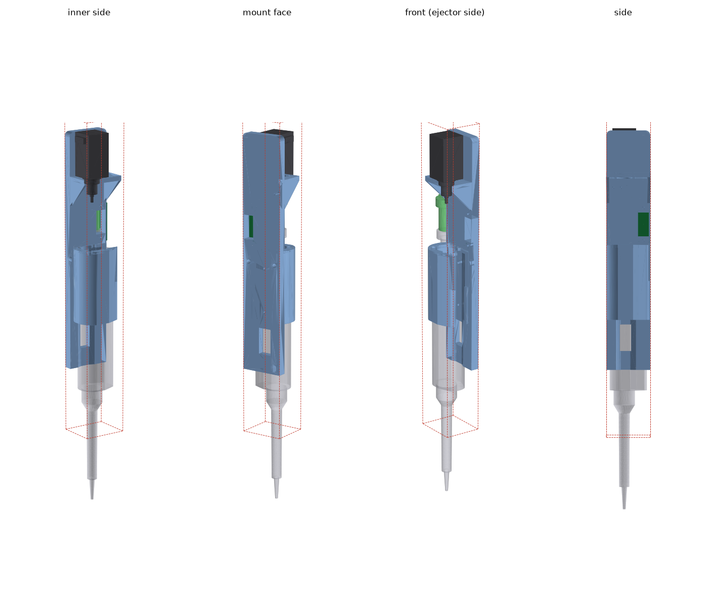

# OT2-Pipette: a precise 0.1–2.5 µl manual pipette as a native Opentrons OT-2 tool

Prototype V0.3. An ONiLAB (DLAB TopPette) 0.1–2.5 µl manual pipette sits in a 3D-printed frame
that bolts to an OT-2 pipette mount like the plate gripper. The robot sees it as a **P20
Single-Channel GEN2** through a 24C02 EEPROM, or an ESP32-S3 emulating it, on the standard
ribbon. The robot's own plunger driver moves a YPF Motors 20K-2AB-12.7 linear actuator (size 8,
1 mm lead) that presses the pipette's plunger button.

Inventor: `INVENTOR/OT2-Pipette V0.3.iam` and `- eject variant.iam` are native and parametric.
Edit the values in `INVENTOR/OT2-Pipette V0.3 - parameters.ipt`, which every part and assembly
links; assembly parameter `travel` moves the plunger stroke.



Report (shareable overview): [docs/report.md](docs/report.md) · design note with decisions,
checks and open points: [docs/pipette_tool.md](docs/pipette_tool.md) · pinout and identity board:
[electronics/README.md](electronics/README.md).

## Quick start

```bash
cd PipetteTool/cad
uv run --with cadquery python pipette_tool.py                       # build, check, export STEP/STL to out/
uv run --with cadquery --with matplotlib python render_pipette_tool.py
C:\Users\benir\miniforge3\envs\pyinventor\python.exe build_inventor.py   # native Inventor parts + INVENTOR/*.iam
uv run --with cadquery python check_native.py                       # native parts == CadQuery parts
cd ../ot2
python onilab_tool.py                                               # plunger positions, volume map
python configure_pipette.py <robot-ip> left --apply                 # after the robot shows "P20 GEN2"
```

1. Measure the robot (top mount screws → GEN2 top face, socket position) and the pipette (list in
   `docs/pipette_tool.md`, "Open points"), set the values in `cad/pipette_tool.py` and
   `ot2/onilab_tool.py`, rebuild.
2. Print `frame` upright (PETG/ASA, 205 mm) and `yoke` (PETG or resin); press 3 Ruthex M3 inserts
   into the mount face and one M2.5 insert into the yoke.
3. Cut off the pipette's finger hook. Slide the pipette up into the sleeve, then tighten the 2 M3
   grub screws from the mount side.
4. Mount the actuator (4 × M2 from below), screw the yoke onto its shaft, fit the switch.
5. Program the EEPROM (`firmware/ot2_eeprom_writer`) or flash the ESP32-S3 emulator
   (`firmware/ot2_eeprom_emulator_esp32s3`, option B), wire the board (`electronics/README.md`).
6. Mount on the OT-2, check it is detected, run `configure_pipette.py`, calibrate pipette offset and
   tip length in the App, then calibrate volumes gravimetrically.
7. Use it in protocols through `OnilabPipette` (`ot2/example_protocol_onilab.py`): volumes in real µl;
   tips come off in the printed stripper (plunger ejection needs a ≥ 18 mm stroke actuator and the
   eject-variant yoke).
