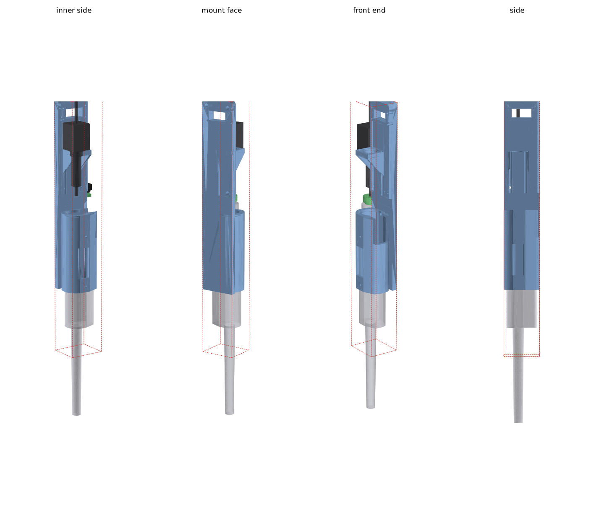
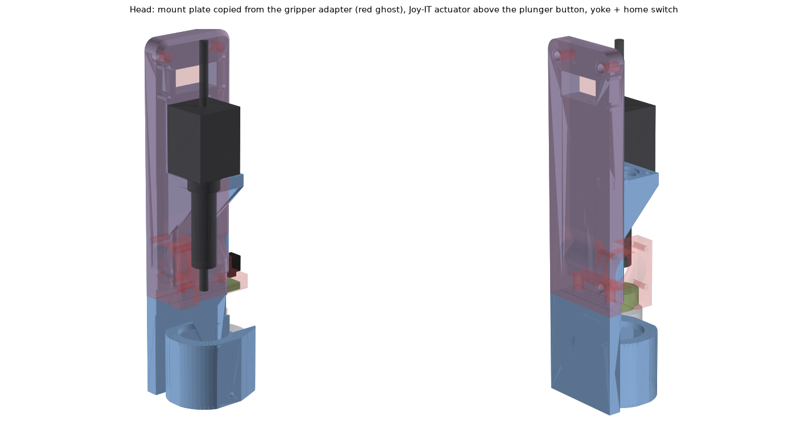

# OT2-Pipette V0.1 — ONiLAB 0.1–2.5 µl pipette as a native OT-2 tool

## The ask (2026-10-30)

Include a more precise, low-cost manual pipette (ONiLAB single-channel 0.1–2.5 µl) as a tool on
the Opentrons OT-2. Motorise it (non-captive/captive linear steppers; a second motor for the tip
ejector is fine). Find out whether the OT-2's I²C pipette interface or USB should drive it, imitate
the existing protocols so it can be used like a standard Opentrons pipette, reuse the gripper's
interface dimensions, and look for prior art. Build a 3D-printable first prototype.

## What was built

| File | What |
|---|---|
| `cad/pipette_tool.py` | parametric CadQuery model + checks + exports (`uv run --with cadquery python pipette_tool.py`) |
| `cad/out/OT2-Pipette V0.1 - frame.step/.stl` | one printed part: mount plate + motor shelf + switch seat + header window + clamp, 32.3 × 204 × 37.5 mm, 71 cm³ |
| `cad/out/OT2-Pipette V0.1 - yoke.step/.stl` | disc on the actuator shaft (M3 insert), flat pad on the plunger button, switch tab |
| `cad/out/OT2-Pipette V0.1 - tip stripper.step/.stl` + `openuc2_tipstripper_3_slot.json` | deck-slot stripper and its OT-2 labware definition |
| `cad/out/OT2-Pipette V0.1 - assembly.step` | frame, yoke, Joy-IT actuator, switch, pipette envelope |
| `cad/render_pipette_tool.py` | figures in this folder |
| `firmware/ot2_eeprom_writer/` | writes the OT-2 identity into a 24C02 |
| `electronics/README.md` | ribbon pinout, identity board, checks |
| `ot2/onilab_tool.py` | robot ↔ tool numbers: plunger positions, currents, real ↔ commanded µl |
| `ot2/configure_pipette.py` | writes the plunger positions/currents into the robot (HTTP, robot-server v8) |
| `ot2/example_protocol_onilab.py` | protocol with a real-µl wrapper and tip stripping; passes `opentrons_simulate` 8.8.2 |

## How it works

1. **Identity (I²C).** A 24C02 on the tool answers at 0x50/0x51 with the `opentron` signature and
   model `p20_single_v2.2`. The OT-2 then treats the tool as a P20 Single-Channel GEN2: App,
   Protocol Designer, `load_instrument("p20_single_gen2", ...)`, calibration all work.
2. **Plunger (stepper wires of the same ribbon).** The robot's plunger driver moves the Joy-IT
   NEMA08-04LA captive actuator (Tr3.5 × 4, 200 steps) mounted coaxially above the plunger button.
   GEN2 plunger = 3200 µsteps per robot-mm at 1/32 → 0.5 rev → **2.0 mm real travel per robot-mm**.
   Its captive spline keeps the yoke from turning; the force on the button is on the axis.
3. **Home switch.** The yoke's tab lifts a D2F-L lever 1 mm above the rest position.
4. **Positions** (robot-mm, positive up, written by `configure_pipette.py`): top 18.5 (pad 0.5 mm
   above the button), bottom 15.75 (first stop, 5 mm), blowout 14.25 (+3 mm), dropTip = blowout.
5. **Volumes.** The robot converts µl to plunger travel with the P20 ul/mm table. The wrapper inverts
   this: real µl → commanded µl (0.25 → 0.155, 1.0 → 0.709, 2.5 → 1.717). Real flow rate 1 µl/s
   → `flow_rate` 0.76.
6. **Tips** are picked up by pressing the cone into the rack (robot's Z, current overridable).
   V0.1 takes them off in the printed stripper (collar under a plate, slide, lift); a `drop_tip()`
   at the same spot then clears the robot's tip state.

## Decisions and why

- **Native ribbon instead of USB for the plunger** — the I²C bus only identifies; motion is the
  robot's own stepper axis. Using those wires is the only way to get the standard API, App and
  calibration without patching the robot software. USB/XIAO stays for extra actuators.
- **Emulate the P20 GEN2** — its nozzle sits lowest of all OT-2 singles (183.8 mm above the deck at
  Z home), closest to the long ONiLAB stack; P20 tips/ranges are closest. GEN1 P10 would suit the
  0.24 A motor better (idle 0.05 A) but its nozzle is ~49 mm higher.
- **Everything inside the GEN2 envelope** (32.34 mm from the mount face, 37.5 mm along the bar) above
  the gantry-shroud line: the neighbouring pipette is only ~1.7 mm away and the upper part of a
  pipette lives inside the gantry shroud at Z home with no headroom above the top datum.
  Consequence: actuator coaxial **above** the button, nothing beside the pipette.
- **Mount plate copied from the gripper adapter** (same mount face x = −9.5, same three M3 inserts
  that take the mount's two captive top screws and the M3×6 bottom screw; checked against the
  adapter STEP). The adapter itself cannot be reused: its gripper motor block sits where the yoke
  and switch must be.
- **One printed frame** (head + clamp): a joint between them has no room for screws inside the
  envelope. 204 mm tall, prints upright on a Prusa MK4 / Form 4. Motor shelf on 45° gussets.
- **Pipette inserted from below**, stops with its shoulder against the sleeve's top ledge (repeatable
  height, takes the tip pick-up force), held by two M3 grub screws on the flat. Windows for the
  ejector button (front) and the volume display (side).
- **Rigid pad, no ejection by the plunger motor in V0.1** — the Joy-IT gives ~10 N; blow-out may
  already need most of it. Ejection by over-travel needs a spring pad (+10 mm height) and ~40 N.

## Checks (`pipette_tool.py`, all passing)

- Actuator rear screw end exactly at the top datum (y = 53) — no part sticks up into the shroud.
- Cone end **13.5 mm below** the P20 nozzle (Z headroom lost; pipette-offset calibration absorbs it).
- Frame x −9.50..22.84, z ±18.75; yoke x −0.10..16.20 — inside the envelope.
- Frame clear of pipette and actuator; yoke clear of frame and switch at 0 and 9 mm travel; tab
  reaches the switch above rest.
- Insert axes and mount face/top coincide with `OT2-Gripper V1-1 - OT2-interface adapter`.
- Shroud line (y −220) below the frame (−151).
- `opentrons_simulate` 8.8.2 runs the example protocol including the stripper labware.

## Measured facts used (sources in the report)

- Opentrons v8.8.2: `M369–M372` read/write ID/model; EEPROM layout 0x00 signature, 0x30 ID, 0x60
  model; GEN2 single plunger 3200 steps/mm, home 172.15, travel 60; P20 GEN2 top 19.5 / bottom −8.5 /
  blowout −13 / drop −27, run 1.0 A, idle 0.3 A, homing 1.0 A; overridable: top, bottom, blowout,
  dropTip (−20..30), plungerCurrent, dropTipCurrent/Speed, pickUp*, tipLength (0.1–2 A).
  `load_instrument` raises if no EEPROM model is read.
- GEN2 single: 44.50 × 32.34 mm, top datum → P20 nozzle 330.5 mm; nozzle 183.77 mm above deck at
  Z home; top datum ≈ 514 mm; shroud from ≈ 241 mm (GEN2 white paper, OT-2R manual).
- ONiLAB-Dev-Core: body Ø 24.66 with flats ±12, nose to 19.25 mm in front of the axis, body
  0–100 mm straight, cone 100 mm (11.7 → 9.3 mm).
- Joy-IT NEMA08-04LA: 0.24 A, 22 Ω, Tr3.5 × 4, stroke 38.1 mm, pilot Ø 16, M2 on 16 mm (gripper
  adapter; datasheet says 15.4 — check), thrust ≈ 10 N at 300–900 pps.

## Open points (MEASURE before printing)

1. ONiLAB: knob top above the body shoulder (12 assumed), shoulder height (121), knob Ø (19),
   first-stop travel at 2.5 µl (5) and blow-out travel (3), button force at both stops,
   ejector button position/travel/force, cone-end and tip-collar Ø (stripper slot 5.0), volume
   window position.
2. **The finger hook must be cut off** (it sits where the sleeve wall is and 34 mm outside the envelope).
3. Robot: is the gripper adapter's top level with a GEN2 pipette's top datum? Where does the OT-2's
   ribbon tab land on the mount face (header window assumed at y = 36)?
4. Joy-IT motor at the GEN2 idle current (0.3 A, not overridable) — check temperature after 30 min;
   else use a 1 mm-lead size-8 captive actuator rated ~0.5–1 A (also self-locking, ~40 N).
5. Gravimetric calibration of the real ↔ commanded volume map (10 dispenses at 0.25/0.5/1/2.5 µl).

## Next steps (V0.2)

- Tip ejection by motor: spring pad + adjustable M3 screw over the ejector button with a 1 mm-lead
  actuator (plunger over-travel, like the GEN2), or a second small actuator driven by a XIAO and
  triggered by a "drop" switch.
- Native Inventor part from the confirmed parameters (cadlib NativePart), CAD-new names/numbers.
