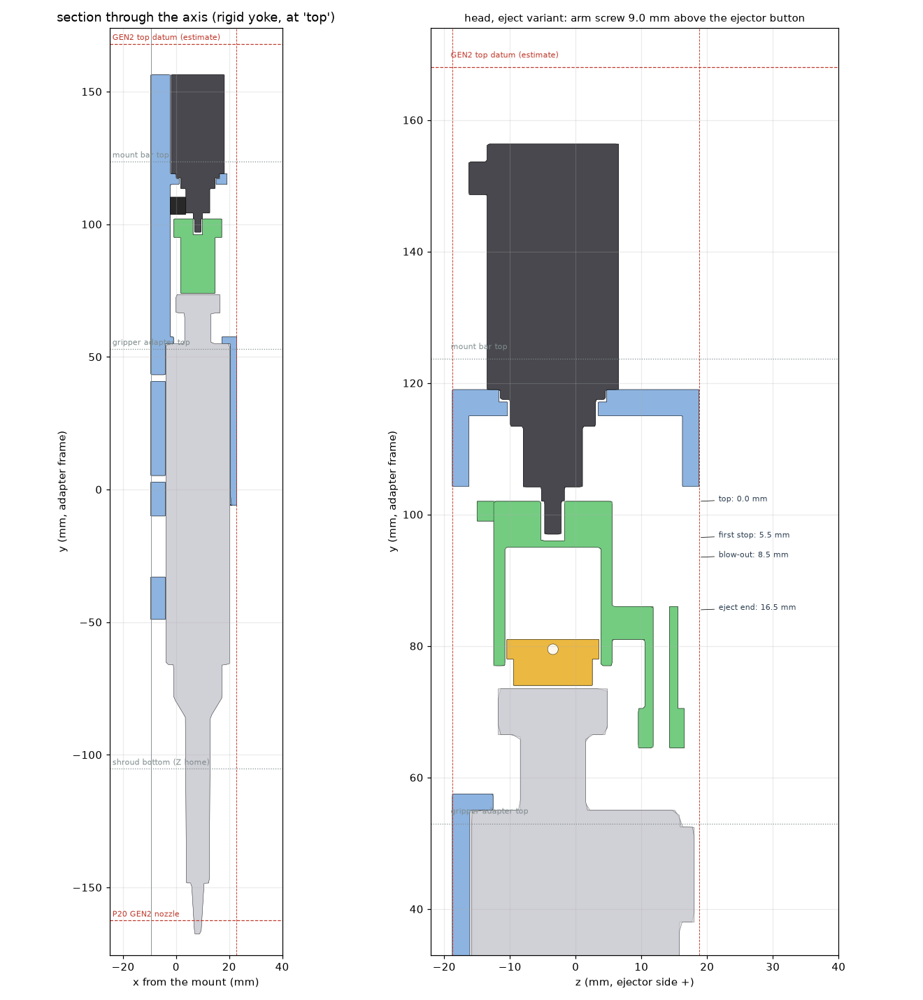

# OT2-Pipette V0.2 — ONiLAB 0.1–2.5 µl pipette as a native OT-2 tool

Design note: what was built, the decisions, the numbers and where they come from, the checks
and the open points. The shareable overview is [report.md](report.md).

## The ask

- **2026-10-30 (V0.1).** Include a more precise, low-cost manual pipette (ONiLAB single-channel
  0.1–2.5 µl) as a tool on the Opentrons OT-2, motorised (linear steppers; a second motor for the
  tip ejector is fine). Find out whether the OT-2's I²C pipette interface or USB should drive it,
  imitate the existing protocols, reuse the gripper's interface dimensions, look for prior art,
  build a 3D-printable first prototype.
- **2026-10-31 (V0.2).** The ONiLAB model's upper part with the hook is right, the tip tube may
  not be: estimate the pipette from product images. Confirm the connector pinout. Use the
  **YPF Motors 20K-2AB-12.7** (CAD-new BUY part, size 8, 1 mm lead) instead of the Joy-IT.
  Opentrons-style ejection or a second motor? Can Science-Jubilee tell where the mount sits on a
  GEN2 and where the ribbon plug lands? Tips: standard 10 µl tips. Convert the shared report to
  markdown in the repo.

## What was built

| File | What |
|---|---|
| `cad/pipette_tool.py` | parametric CadQuery model + 39 checks + exports (`uv run --with cadquery python pipette_tool.py`) |
| `cad/out/OT2-Pipette V0.2 - frame.step/.stl` | one printed part: mount wall with the 3 inserts, sleeve + ledge, header window, motor shelf; 32.3 × 205.3 × 37.5 mm, 65 cm³ |
| `cad/out/OT2-Pipette V0.2 - yoke.step/.stl` | rigid yoke on the actuator's M2.5 shaft end (Ruthex insert), pad face 0.5 mm above the plunger button, switch tab |
| `cad/out/OT2-Pipette V0.2 - yoke eject variant`, `- spring pad` | eject variant: skirt with a spring pad (2 M2 pins in slots) and an arm with an M3 adjust screw over the ejector button |
| `cad/out/OT2-Pipette V0.2 - tip stripper` + `openuc2_tipstripper_3_slot.json` | deck-slot stripper (slot 4.4 mm for 10 µl tips) and its OT-2 labware definition |
| `cad/out/OT2-Pipette V0.2 - assembly.step`, `- assembly eject.step` | frame, yoke(s), YPF actuator, switch, identity board, ONiLAB envelope |
| commit `c8f2271` | V0.1 (Joy-IT, top datum assumed at the adapter top) |
| `cad/ref/YPF-20K-2AB-12.7.stp` | the CAD-new motor, exported from Inventor |
| `cad/render_pipette_tool.py` | the figures below |
| `cad/build_inventor.py` → `INVENTOR/OT2-Pipette V0.2.iam`, `- eject variant.iam` | Inventor assemblies: the printed parts and reference solids imported from the STEP exports, the CAD-new YPF actuator in place, 3 Ruthex inserts, the OT-2 mount bar reference model, the gripper adapter and ONiLAB-Dev-Core (hidden); interference checked |
| `ot2/onilab_tool.py`, `configure_pipette.py`, `example_protocol_onilab.py` | robot numbers (1 mm lead), settings writer, real-µl protocol (passes `opentrons_simulate` 8.8.2) |
| `electronics/README.md`, `firmware/ot2_eeprom_writer/` | pinout (checked against the EAGLE files), identity board, EEPROM writer |

## What changed from V0.1, and why

1. **The GEN2 top datum is ~115 mm above the gripper adapter's top, not level with it.** V0.1
   assumed level. Three independent estimates disagree with that:
   - the OT-2 reference model (`INVENTOR/00_OT-2 Reference_Pipettte.ipt`, green body) is the
     mount bar: 18 × 176.65 × 37.5 mm, top screw pair 26.33 mm apart, bottom screw 89 mm lower —
     the adapter's insert pattern. Its top is 77.65 mm above the top screws (y = 123.65);
   - OT-2R manual photo of a mounted P300 GEN2 (scale from the 32.34 mm face): the bar top sits
     just inside the gantry cover, the pipette continues ~46 mm higher, and the pipette body ends
     ~13 mm below the bar → top datum y ≈ 170;
   - Science-Jubilee guide photo of the GEN2's mount face (scale from its 44.5 mm width and the
     holder's 19.24 mm holes) and the manual photo of the plug at the bar's top block → socket
     ~18-21 mm above the top screws and ~96-103 mm below the top datum → y ≈ 166.

   V0.2 uses `datum_y = 168`. Consequences: P20 nozzle at y = −162.5 (V0.1: −277.5); the tool may
   use the GEN2 outline up to y = 168; with the V0.1 geometry the nozzle would have been ~115 mm
   too low. **One measurement on the robot settles it** (open point 1).
2. **Pipette geometry from the product photos** (ONiLAB = DLAB TopPette: Amazon part number
   `top-0.1-2.5`). Method: pixel profile along the axis of the main photo (lower part blue/black
   on white), axial scale from the Dev-Core body (bottom → top face 121 mm, nose ends at 100 mm:
   both within 1.5 % in the photo), diameters corrected for the ~22° tilt seen on the knob's end
   face; cross-checked on the upright photo (body width = Dev-Core D extent 31.6 mm).

   | | V0.1 | V0.2 (photo) |
   |---|---|---|
   | knob top above the body top face | 12 | 18.5 |
   | knob Ø × height / plunger stem Ø | 19 / – | 16.6 × 7 / 9.9 |
   | below the body: collar | – | Ø 18.1 × 12.6 |
   | taper / ejector sleeve | cone Ø 11.7 → 9.3 × 100 | 7.2 / Ø 9.4 → 8.6 × 62.6 |
   | black tip cone | – | Ø 4.7 → 2.4 × 19.1 (total below the body 101.5) |
   | ejector button | front window | D 12.3–21.5, W ±5, top 2.5 below the body top face |
   | volume window | +x side, 55–88 | **−x flat** (faces the mount), 33–56 above the body bottom |

   The window faces the mount side for an ejector on +z (photo chirality), so V0.2 puts the
   sleeve above it (from 60 mm) and cuts a window through the mount wall to read it off the robot.
3. **Motor: YPF 20K-2AB-12.7** (CAD-new). 20 × 20 × 37.35 mm, closed rear, pilot Ø 16 × 1.5,
   boss Ø 13, anti-rotation housing Ø 9 to 14.8 mm below the face, shaft Ø 3.5 with M2.5 × 5 end
   (retracted 15.8 mm below the face), M2 on 15.4 mm, connector on one side 29.7–34.7 mm from the
   face. 1 mm lead → 0.5 mm yoke travel per robot-mm, ~4× the Joy-IT's force. No rear screw: the
   whole stack is 43 mm shorter than with the Joy-IT.
4. **One frame for both yokes**: `yoke_total` = 28 mm from the shaft shoulder to the pad face
   leaves room for the spring pad; the rigid yoke is a post of the same length.
5. **Pinout confirmed** in `pipette-main.sch` and the motor board (left mount JP4 pin 3 = GND,
   right mount JP7 pin 3 = 5 V; motor JST 1A/1B/2B/2A; end-stop D2F-L COM → MIN, NC → GND).

## How it works

1. **Identity (I²C).** A 24C02 answers at 0x50/0x51 with the `opentron` signature and model
   `p20_single_v2.2`; the OT-2 treats the tool as a P20 Single-Channel GEN2.
2. **Plunger.** The robot's plunger driver moves the YPF actuator coaxially above the button.
   Travel u below the robot's 'top' (real mm): pad touches 0.5, first stop 5.5, blow-out 8.5;
   usable 11.2 (12.7 stroke − 1.2 above 'top' − 0.3 at the far end).
3. **Home switch** on the wall face; the yoke's tab lifts its lever 0.6 mm above 'top'
   (0.6 mm before the retracted hard stop).
4. **Robot positions** (robot-mm, written by `configure_pipette.py`): top 17.8, bottom 6.8,
   blowout 0.8, dropTip 0.8 (= blowout: no ejection with this stroke). Run current 0.5 A.
5. **Volumes** in real µl through the wrapper: 0.25 → `aspirate(0.709)`, 1.0 → 2.852,
   2.5 → 7.442; real 1 µl/s → `flow_rate` 3.05.
6. **Tips**: standard 10 µl tips, picked up by pressing the cone into the rack; removed in the
   printed stripper (slot 4.4 mm: wider than the cone where it passes the plate, ~3.4-3.8 mm,
   narrower than a 10 µl tip rim, ~5-5.6 mm).

## Tip ejection: Opentrons over-travel or a second motor?

- **What Opentrons does (GEN2 singles):** no reverse move. In `drop_tip()` the plunger keeps going
  *down* past blow-out to its `dropTip` position (P20 GEN2: −27 vs blow-out −13) and pushes the
  ejector; it is purely mechanical. The robot applies its own `dropTipCurrent` and `dropTipSpeed`
  there; both are overridable per pipette.
- **The same on our tool (eject variant, modelled):** the yoke carries a spring pad on the
  plunger button and an arm with an M3 screw 9.0 mm above the ejector button. Down to blow-out
  the pad is rigid (spring preload > blow-out force); past blow-out the button stops, the spring
  gives way and the screw pushes the ejector 7 mm. No board, no cable, no extra power;
  `drop_tip()` works anywhere (trash, rack). Needs 16.5 mm of travel below 'top' → **an
  actuator stroke ≥ 18 mm**, and about 20–35 N at the end (spring 10-15 N + ejection 10-20 N,
  MEASURE) — fine for a 1 mm lead at low speed with `dropTipCurrent` raised for the short move.
- **With the 12.7 mm stroke** pipetting fits (8.5 of 11.2 mm), ejection does not. Same motor
  with a 19.05 or 25.4 mm stroke (ask YPF; 11.7 mm headroom is left above the motor if the body
  grows) → eject variant; until then the stripper.
- **Second motor:** no board has to interpret steps — a second switch below blow-out (only
  `drop_tip()` goes there) tells a XIAO to run the ejector motor. But it needs its own power (pin 6
  is meant for the EEPROM; use USB from the robot), a cable, firmware, and room for a second
  actuator 15 mm off-axis next to the main motor inside 32 × 37 mm. Kept as the fallback.

**Recommendation: over-travel, with a longer-stroke YPF 20K.**

## Decisions and why (kept from V0.1)

- **Native ribbon instead of USB for the plunger**: I²C only identifies; motion is the robot's
  own stepper axis. Using those wires gives the standard API, App and calibration.
- **Emulate the P20 GEN2**: lowest nozzle of the OT-2 singles, closest volume range and tips.
- **Everything above the shroud line inside the GEN2 outline** (32.34 mm from the mount face,
  37.5 mm along the bar): the neighbouring pipette is 1.7 mm away. Hence the actuator coaxially
  above the button, and the finger hook cut off (it sticks out 34 mm behind the axis; the
  GEN2 is 44.5 mm deep in total).
- **Insert pattern copied from the gripper adapter** (same mount face x = −9.5 and insert axes;
  checked against the adapter STEP).
- **Pipette inserted from below**, top face against the ledge (takes the tip pick-up force), held
  by 2 M3 grub screws through the mount wall onto the −x flat (take the plunger force; set before
  mounting). A slot in the sleeve lets the ejector button pass.
- **Nozzle 5 mm below the P20's** (`nozzle_offset`) to keep 11.7 mm between the motor and the
  estimated top datum; pipette-offset calibration absorbs it.

## Checks (`pipette_tool.py`: 38 ok, 1 info; `build_inventor.py`: interference)

- Motor rear 11.7 mm below the estimated top datum; cone end 5.0 mm below the P20 nozzle.
- Pipetting stroke fits (blow-out 8.5 of 11.2 mm); ejection needs a stroke ≥ 18 mm (info).
- Frame, both yokes and the actuator with its connector housing inside the envelope.
- Frame clear of the pipette at rest and with the button at blow-out and the ejector pressed;
  clear of actuator, switch, identity board.
- Both yokes clear of the frame at −0.6 / 0 / 8.5 / 11.2 mm and of the switch; tab lifts the
  lever; yokes clear of the pipette at 'top'; eject arm clear of the button at blow-out; spring
  pad clear of the frame.
- Insert axes, mount face and adapter top identical to `OT2-Gripper V1-1 - OT2-interface adapter`.
- Frame and the pipette above the shroud line (y = −105.3) inside the GEN2 outline.
- Frame, yokes and pad are one solid each (two 3 mm³ ledge slivers between knob hole, screw
  channels and window are dropped).
- `opentrons_simulate` 8.8.2 runs the example protocol including the stripper labware.
- Inventor (`build_inventor.py`, both assemblies): 0 mm³ between frame and pipette envelope,
  actuator, switch, identity board and the OT-2 mount bar; yoke(s) and pad clear of actuator,
  envelope and frame; the three inserts overlap their 4.1 mm holes by 12.6 mm³ each (knurl, by
  design); no missing references. The mount bar reference model, placed with its screw holes on
  the insert axes, lands on the gripper adapter's outline (x −27.5…−9.5, y −53…123.65, z ±18.7),
  and the CAD-new YPF part draws its shaft fully retracted, 1.2 mm above the robot's 'top'.

## Open points (MEASURE before printing)

1. **Robot:** with a GEN2 mounted, the height from the axis of the two top mount screws to the
   pipette's top face (V0.2 assumes 122 mm: `datum_y − 46`), and where its socket sits on the
   mount face (V0.2 header 30 mm above those screws, on the +z side). Five minutes with calipers.
2. **Pipette:** first-stop travel at 2.5 µl and blow-out travel (5 + 3 assumed), button forces at
   both stops, ejector button position/travel/force (7 mm assumed), knob Ø/height, tip cone Ø
   where a 10 µl tip seals, the 10 µl tip's rim Ø and length.
3. **Motor:** coil resistance / rated current; whether YPF has the 20K-2AB with 19.05 or 25.4 mm
   stroke and its length.
4. **Finger hook** must be cut off (still the case).
5. Gravimetric calibration of the real ↔ commanded volume map (10 dispenses at 0.25/0.5/1/2.5 µl).

## Next steps

- After the measurements: set the parameters, rebuild, print frame (PETG/ASA, upright, 205 mm)
  and yoke, test on the robot with the rigid yoke and the stripper.
- With a ≥ 19 mm stroke actuator: print the eject variant, choose the spring (preload above the
  blow-out force, ≥ 8 mm travel), set `EJECT_BY_PLUNGER = True` in `ot2/onilab_tool.py`.
- Native parametric Inventor parts from the confirmed parameters (cadlib NativePart) to replace the
  imported bodies in `INVENTOR/`; CAD-new names/numbers if the tool moves into CAD-new.
