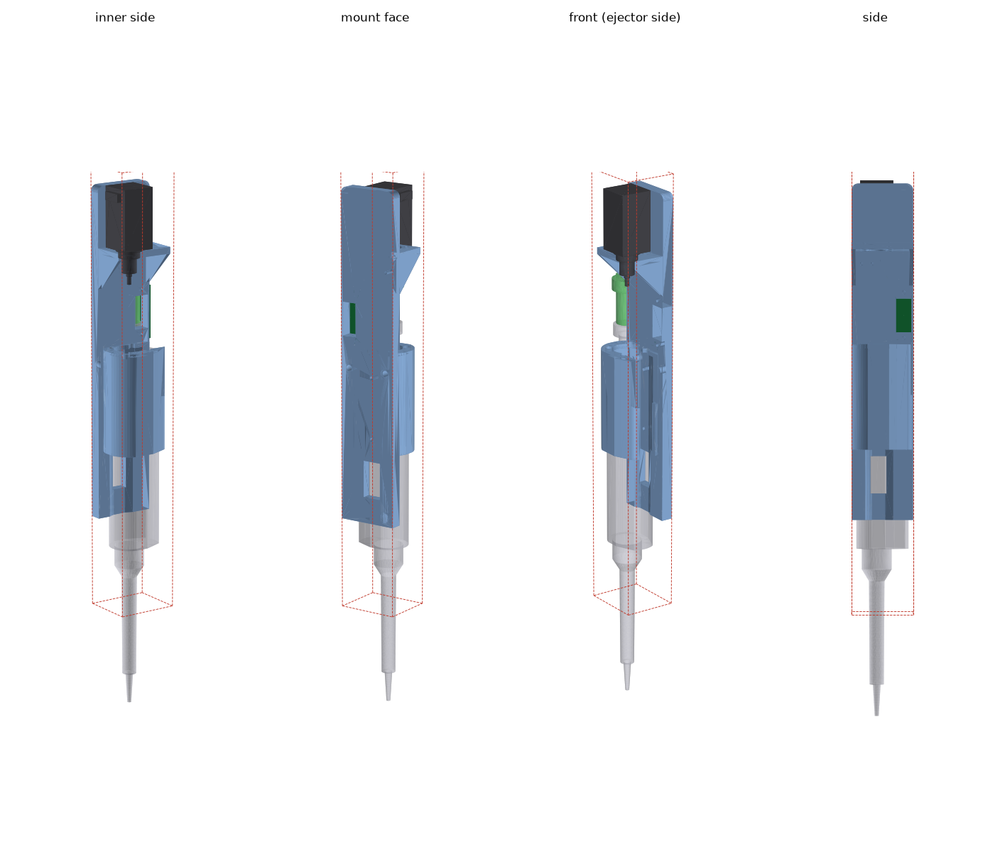
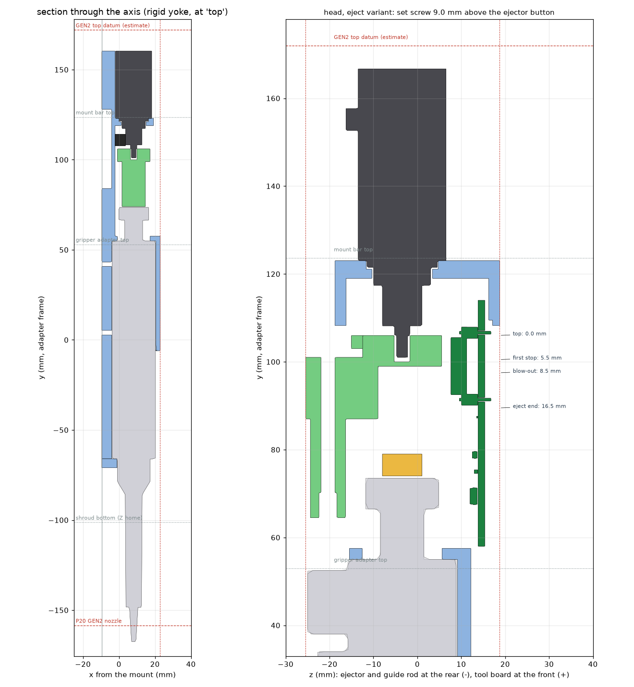
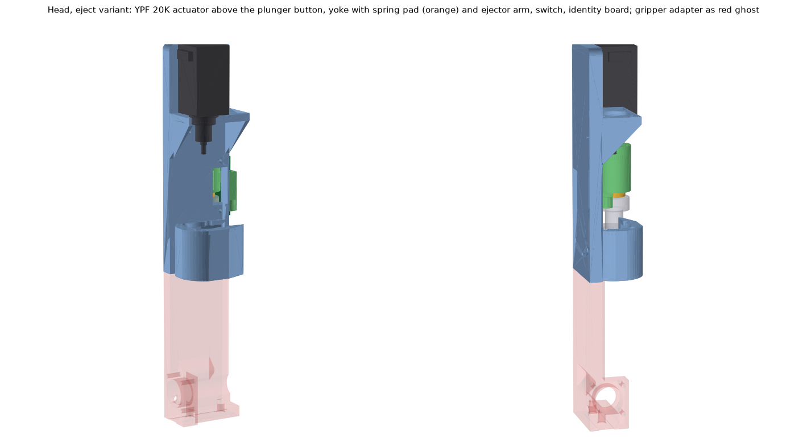
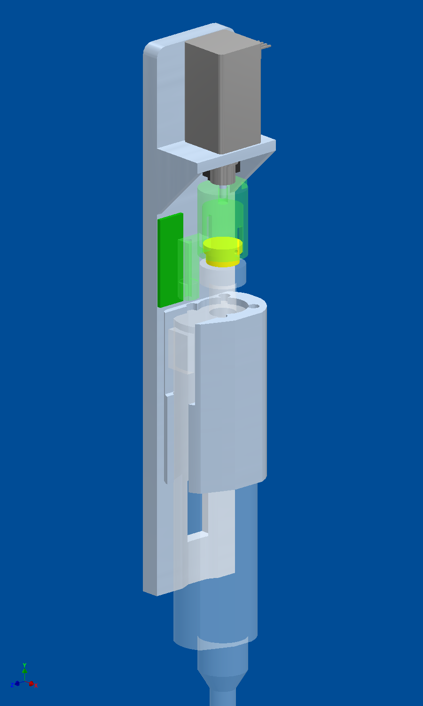

# A 0.1–2.5 µl ONiLAB pipette as a native OT-2 tool

openUC2 · OT-2 lab automation · prototype V0.3 · 1 Nov 2026

Research on the OT-2 pipette interface, prior art, and a printable holder with motor, identity
electronics and protocol code. Files live in `PipetteTool/` of the openUC2-OT2-PlateGripper
repository. This page is the markdown version of the shared report (V0.1, 30 Oct), brought up to
V0.3; engineering details are in the design note [pipette_tool.md](pipette_tool.md).

**New in V0.3:**
- The Inventor model is native and parametric. One parameter part drives every part and both
  assemblies, and an assembly parameter `travel` moves the plunger stroke.
- An ESP32-S3 can replace the identity EEPROM.
- The frame's ledge is cut back between the two front screw channels.

## The short answer

| Question | Answer |
|---|---|
| **Drive the motor over I²C?** | **No. The I²C bus only identifies the pipette.** The robot reads a small EEPROM over I²C to learn which pipette is attached. Motion never goes over I²C: the plunger is an ordinary stepper axis of the robot's motion board, wired through the same 10-pin ribbon. |
| **So how do we get it "native"?** | **Put our motor on the robot's plunger wires.** An EEPROM that says `p20_single_v2.2`, a home switch and a stepper on the ribbon. The robot then sees a P20 GEN2 and drives our actuator itself. The App, Protocol Designer, calibration and `aspirate()` all work. No microcontroller is needed. |
| **USB / XIAO?** | **Only for extra actuators.** A XIAO over USB fits a second motor, such as a tip ejector, driven by plain serial from a protocol or by imitating an Opentrons module's G-code. It cannot make the robot accept a pipette in the mount: that needs the EEPROM. |

## How the OT-2 talks to a pipette

Checked in the Opentrons source (release v8.8.2), the OT-2 Smoothieware fork and Opentrons'
published EAGLE files (`pipette-main.sch`, motor board `5001-stepper-drivers`).

### The ribbon connector (2×5, 2.54 mm, shrouded, 0.5 m cable)

| Pin | Signal | Inside an Opentrons pipette | On our tool |
|---|---|---|---|
| 1 / 2 | SCL / SDA, 5 V, 10 kΩ pull-ups on the robot | AT24MAC402 EEPROM | 24C02 EEPROM |
| 3 | Address: GND on the left mount, 5 V on the right | EEPROM A0 → 0x50 / 0x51 | same |
| 4 | MIN, plunger home switch (pull-up on the motor board, high = pressed) | Omron D2F-L: COM to signal, NC to GND | same type of switch |
| 5 / 6 | GND / +5 V | EEPROM supply (through a PNP) | EEPROM supply |
| 7 / 8 | MOTOR_2A / 2B (coil B) from the robot's A5984 driver (1/32 step, ~36 V) | plunger motor | YPF 20K linear actuator |
| 9 / 10 | MOTOR_1A / 1B (coil A) | plunger motor | YPF 20K linear actuator |

**Verify** 5 V on pins 6/5 and the address level on pin 3 with a multimeter before plugging
anything in. Pin drawing and wiring: [electronics/README.md](../electronics/README.md).

### What the robot reads and does

- **Identity:** G-codes `M369/M371` read the ID and model, `M370/M372` write them (`M373/M374` a
  spare data field). EEPROM layout: `opentron` signature at 0x00, ID at 0x30, model at 0x60, 32
  bytes each, zero-padded. Reads run at 10 kHz in 8-byte chunks, with both plunger motors
  switched off during the read.
- **No EEPROM, no pipette:** `load_instrument()` raises *"requested, but no instrument is
  present"*. That rules out any USB-only approach for the pipette mount.
- **Plunger axis:** GEN2 singles use 3200 microsteps per robot-mm (GEN1: 768). The P20 GEN2
  positions are top 19.5, bottom −8.5, blow-out −13 and drop −27, with currents run 1.0 A, idle
  0.3 A and homing 1.0 A.
- **Settings you can change per pipette ID** over the robot's HTTP API
  (`PATCH /settings/pipettes/{id}`): top, bottom, blowout and dropTip (−20 to 30 mm), plunger and
  drop-tip current (0.1–2 A), drop speed, pick-up current, distance and speed, and tip length.
  You cannot change the idle current, the homing current or the µl/mm table.

### Ways to connect a motor, compared

| Route | What it gives | Cost / risk | Use for |
|---|---|---|---|
| **Native ribbon**: EEPROM + switch + our stepper on pins 7–10 | Standard API, App, Protocol Designer, calibration, tip tracking. The robot moves the plunger itself. | Must live with the robot's driver currents. Volumes need a conversion layer (P20 µl/mm table). | **Plunger. Chosen.** |
| **ESP32-S3 on the pipette I²C bus**, emulating the EEPROM | Identity in firmware, no EEPROM to buy; ID set over USB. As a command channel (DATA field, `M374`) it is useless: private driver calls only, no motion commands. | 5 V bus (level shifter), 10 kHz; needs an S2/S3/C3-class chip that holds the clock while it answers. | **Identity: option B (V0.3)**; as a command channel, no |
| **USB serial**: XIAO + driver, pyserial in the protocol | Full control of any extra motor or sensor (how the plate gripper works). | Cable from the gantry to the robot's USB port. Not visible to the App. | Tip-ejector motor, sensors |
| **USB module imitation**: VID:PID 04d8:ee90, mag-deck G-code | `load_module("magnetic module")` → `engage(height)` moves a motor "natively". | Borrows Microchip's vendor ID (private use only). Semantics are a stretch. Nobody has published this. | Possible later |

## Prior art

- **Science-Jubilee** (Machine Agency, UW) runs OT-2 GEN1/GEN2 pipettes on a Jubilee tool
  changer. A Duet board drives the pipette's stepper directly and tips come off by plunger
  over-travel: the same electrical interface used the other way round. Their holder screws onto
  the pipette with its own 4-hole pattern (19.24 × 89.5 mm), not the OT-2 mount's, so it does not
  give the mount position directly; their build-guide photos do show the GEN2's socket.
- **Opentrons/ot2** on GitHub has the EAGLE files for the pipette boards and the motor board:
  pinout, EEPROM part, A5984 driver, end-stop wiring.
- **Pipettin-bot / Open Lab Automata**, **OpenLH**, **Aliqbot**, **ReP**, **BioCloneBot** and
  **FINDUS** motorise pipettes or syringes on DIY robots; tips come off by a motor push or by
  springs and stripping bars.
- Nazeri et al., HardwareX 2025, built a printed OT-2 tool that the robot picks up as if it were a
  tip. iGEM Marburg 2019 mounted a camera on the OT-2 arm.
- **We found no public project** that runs a third-party pipette in an OT-2 mount through the
  robot's own pipette interface.

## The geometry that decides the design

- A GEN2 single pipette is **32.34 mm** wide (robot X, away from the mount) and **44.5 mm** deep;
  its top datum is 330.5 mm above the P20 nozzle, and at Z home that nozzle is 183.8 mm above the
  deck. The two mounts are 34 mm apart: **1.7 mm** to the neighbouring pipette.
- **New in V0.2: the GEN2 top datum sits ~115 mm above the gripper adapter's top**, not level
  with it. The mount bar in the OT-2 reference model carries the adapter's screw pattern and
  reaches 78 mm above the top screws; the OT-2 manual and Science-Jubilee photos put the pipette
  top ~120 mm above those screws (estimates 166–171 mm in the adapter frame; V0.2 uses 168).
  To be confirmed on the robot with one caliper measurement.
- At Z home the pipette's upper part sits inside the gantry cover (from 273 mm below the top
  datum up); there is no known headroom above the top datum.
- The ONiLAB is a DLAB TopPette (Amazon part number `top-0.1-2.5`). Upper part from
  `ONiLAB-Dev-Core`: 24 mm across the flats, nose to 19.25 mm in front of the axis, finger hook
  34 mm behind it. From the product photos: knob Ø 16.6 mm, 18.5 mm above the body; below the
  body 101.5 mm (collar Ø 18.1, ejector sleeve Ø 9.4 → 8.6, black tip cone Ø 4.7 → 2.4 × 19 mm).

This rules out a motor beside the pipette: the actuator sits **coaxially above the plunger
button**, and the whole tool stays inside the GEN2 outline up to the estimated top datum.

## Prototype V0.3









### How it works

1. **Frame** (one printed part, 32.3 × 205.3 × 37.5 mm, 65 cm³, prints upright). Mount wall with
   the gripper adapter's three M3 inserts, sleeve with a ledge on the pipette's top face, window
   for the identity board's header, shelf for the actuator. The pipette slides in from below; two
   M3 grub screws from the mount side hold it.
2. **Actuator: YPF Motors 20K-2AB-12.7** (size 8, captive, 1 mm lead, 12.7 mm stroke, closed rear).
   The robot's 3200 µsteps per robot-mm give **0.5 mm of yoke travel per robot-mm**.
3. **Yoke** on the M2.5 shaft end (heat-set insert), pad 0.5 mm above the button; its tab lifts
   the home switch 0.6 mm above 'top'.
4. **Positions written to the robot** (robot-mm): top 17.8, bottom 6.8 (first stop, 5 mm),
   blowout 0.8 (+3 mm), dropTip = blowout. Run current 0.5 A, pick-up 0.15 A.
5. **Tips**: standard 10 µl tips, pressed on by the robot as usual, taken off in the printed
   stripper (with its own labware definition); a `drop_tip()` there clears the robot's tip state.

### Volumes in real microlitres

The robot converts µl to plunger travel with the P20 table; the protocol wrapper `OnilabPipette`
inverts it, so protocols are written in real µl. Theoretical values until a gravimetric
calibration replaces them.

| Real volume (µl) | 0.10 | 0.25 | 0.50 | 1.00 | 1.25 | 2.00 | 2.50 |
|---|---|---|---|---|---|---|---|
| Commanded on the P20 (µl) | 0.255 | 0.709 | 1.342 | 2.852 | 3.610 | 5.913 | 7.442 |

The example protocol passes `opentrons_simulate` 8.8.2, including the stripper labware:

```
Aspirating 2.852227613586237 uL from A1 of Corning 96 Well Plate 360 µL Flat on slot 2 at 1.5230000000000001 uL/sec
Dispensing 2.852227613586237 uL into C2 of Corning 96 Well Plate 360 µL Flat on slot 2 at 3.0460000000000003 uL/sec
Moving to A1 of openUC2 tip stripper (ONiLAB tool) on slot 9
Dropping tip into A1 of openUC2 tip stripper (ONiLAB tool) on slot 9
```

### Tip ejection

Opentrons GEN2 singles eject by **plunger over-travel**: in `drop_tip()` the plunger keeps going
down past blow-out and pushes the ejector, purely mechanically, with its own overridable current
and speed. Our eject variant does the same: a spring pad gives way on the plunger button past
blow-out while an arm screw pushes the ejector button. No board, cable or extra power. It needs
16.5 mm of travel, i.e. an **actuator stroke ≥ 18 mm**; the 12.7 mm YPF covers pipetting
(8.5 of 11.2 mm usable) but not ejection, so V0.2 keeps the stripper. A second motor would not need
step decoding (a switch below blow-out can trigger a XIAO), but it needs USB power, a cable,
firmware and room for a second actuator. **Recommendation: the same YPF 20K with a 19.05 or
25.4 mm stroke and the eject variant.**

### Checks the model runs (39 ok, 1 info)

- Motor rear 11.7 mm below the estimated top datum; cone end 5 mm below the P20 nozzle.
- Frame, yokes and actuator inside the GEN2 outline; everything above the shroud line too.
- Frame clear of the pipette (at rest, at blow-out with the ejector pressed), actuator, switch
  and identity board; both yokes clear of frame and switch over the whole travel.
- Insert axes, mount face and adapter top identical to `OT2-Gripper V1-1 - OT2-interface adapter`.
- Info: ejection needs a stroke ≥ 18 mm.
- Inventor assembly: no overlaps except the three heat-set inserts in their holes (by design),
  also at blow-out and full stroke (`travel`); the tab trips the switch at −0.6 mm.
- Native Inventor parts: all healthy, every dimension bound to a parameter. Fifteen parameters
  were changed together and every part rebuilt; after reverting, all volumes were back. The
  geometry matches the CadQuery parts within 0.1 %.
- The ESP32-S3 sketch compiles (arduino-esp32 3.3.12); not yet tested on hardware.

### Parts

| Part | Qty | Note |
|---|---|---|
| Frame, yoke, tip stripper | 1 each | Frame PETG/ASA upright (205 mm); yoke PETG or resin |
| YPF Motors 20K-2AB-12.7 linear actuator | 1 | CAD-new BUY part; rated current to be checked |
| Ruthex inserts | 3 × M3, 1 × M2.5 | 3 in the mount face, 1 in the yoke |
| 24C02 EEPROM, 2×5 shrouded header, 100 nF, perfboard | 1 | identity board; programme it with the XIAO sketch |
| or: XIAO ESP32-S3 + BSS138 level shifter, 10 k + 15 k (+ the header and perfboard) | 1 | option B: no EEPROM; `firmware/ot2_eeprom_emulator_esp32s3` |
| Omron D2F-L micro switch | 1 | home switch, 2 × M2 self-tapping |
| M2×6 (motor), M3 grub screws (clamp), JST-XH 4- and 2-pin | 4 / 2 / 1+1 | |
| Eject variant only: spring pad, M3×12 + nut, 2 × M2 pins, compression spring | 1 | spring: preload above the blow-out force, ≥ 8 mm travel |

## Risks and limits

- **Top datum estimate.** All heights hang on y = 168 (photos and the reference model agree within
  ±3 mm, but they are photos). If it is lower, the motor gets closer to the head ceiling; if
  higher, the nozzle is higher than a P20's. Measure before printing.
- **Motor current.** The P20 GEN2 keeps the plunger at 0.3 A idle and homes at 1.0 A (not
  overridable). Check the YPF's rating and its temperature after 30 minutes.
- **Plug position.** The header window sits 30 mm above the top mount screws; the robot's plug was
  estimated at 18–21 mm. The 0.5 m ribbon has slack at its clip; measure and move the window.
- **Volume display** faces the mount: readable through the wall window only off the robot.
- **Software line.** Stay on robot software 8.x. The current `edge` branch of the Opentrons
  repository no longer contains the OT-2 Smoothie driver (checked 30 Oct 2026).

## What we need from you

1. **On the robot** (with a GEN2 mounted): height from the axis of the two top mount screws to
   the pipette's top face (V0.2 assumes 122 mm), and where its 2×5 socket sits on the mount face.
2. **Pipette measurements**: travel to the first stop at 2.5 µl and the blow-out travel; button
   forces at both stops; ejector button position, travel and force; knob Ø and height; tip cone Ø
   where a 10 µl tip seals; the 10 µl tip's rim Ø and length.
3. **Motor**: coil resistance / rated current of the YPF 20K-2AB-12.7; is a 19.05 or 25.4 mm stroke
   version available (and how long is it)?
4. **Finger hook**: still has to be cut off.

## Files

| Path in `PipetteTool/` | Content |
|---|---|
| `cad/pipette_tool.py`, `cad/out/` | Parametric model, checks, STEP/STL of frame, yokes, spring pad, stripper and assemblies, plus the stripper labware JSON (V0.1: commit `c8f2271`, V0.2: `aa6b085`) |
| `cad/ref/` | Reference STEPs: gripper interface adapter, ONiLAB-Dev-Core, YPF 20K, Joy-IT |
| `INVENTOR/OT2-Pipette V0.3 - parameters.ipt`, 8 native parts, `OT2-Pipette V0.3.iam`, `- eject variant.iam` (built by `cad/build_inventor.py`, checked by `cad/check_native.py`) | Native parametric Inventor model: one parameter part linked into every part and assembly; constrained assemblies with the CAD-new YPF actuator, inserts and the OT-2 mount bar reference |
| `firmware/ot2_eeprom_writer/` | XIAO/Arduino sketch that writes the OT-2 identity into a 24C02 (and reads the emulator like the robot) |
| `firmware/ot2_eeprom_emulator_esp32s3/` | XIAO ESP32-S3 sketch that answers the robot like the EEPROM |
| `electronics/README.md` | Ribbon pinout, identity board, plug position, motor, checks on the robot |
| `ot2/onilab_tool.py`, `configure_pipette.py` | Plunger positions, currents and the volume map; writes them to the robot over HTTP |
| `ot2/example_protocol_onilab.py` | Protocol in real µl, with tip stripping |
| `docs/pipette_tool.md` | Design note: decisions, facts, checks, open points |

## Sources

- Opentrons source, release v8.8.2: [smoothie_drivers](https://github.com/Opentrons/opentrons/tree/v8.8.2/api/src/opentrons/drivers/smoothie_drivers), [controller.py](https://github.com/Opentrons/opentrons/blob/v8.8.2/api/src/opentrons/hardware_control/backends/controller.py), [model_constants.py](https://github.com/Opentrons/opentrons/blob/v8.8.2/shared-data/python/opentrons_shared_data/pipette/model_constants.py), [pipette definitions](https://github.com/Opentrons/opentrons/tree/v8.8.2/shared-data/pipette/definitions/2), [robot-server settings](https://github.com/Opentrons/opentrons/blob/v8.8.2/robot-server/robot_server/service/legacy/routers/settings.py)
- OT-2 firmware: [Opentrons/SmoothiewareOT](https://github.com/Opentrons/SmoothiewareOT) (src/modules/utils/instrument)
- OT-2 hardware files: [Opentrons/ot2](https://github.com/Opentrons/ot2) (PCB files: pipette-main, pipette-endstop, stepper drivers)
- [GEN2 pipette white paper](https://insights.opentrons.com/hubfs/Products/Pipettes/GEN2%20Pipette%20White%20Paper.pdf), [OT-2R user manual](https://insights.opentrons.com/hubfs/Products/OT-2/OT-2R%20User%20Manual.pdf) (attach-pipette photos)
- [machineagency/science-jubilee](https://github.com/machineagency/science-jubilee) (OT-2 pipette tool, assembly guide)
- `INVENTOR/00_OT-2 Reference_Pipettte.ipt` in this repository (mount bar geometry)
- Module detection: [Opentrons/buildroot](https://github.com/Opentrons/buildroot) udev rules; [opentrons-modules](https://github.com/Opentrons/opentrons-modules)
- [ONiLAB single-channel pipette 0.1–2.5 µl (Amazon.de)](https://www.amazon.de/dp/B0DGTBPQR5) (product photos); [DLAB MicroPette specification](https://cdn.shopify.com/s/files/1/0521/5312/2997/files/MicroPette.pdf)
- YPF Motors 20K-2AB-12.7: openUC2-CAD-new `BUY - Stepping motor - 20K-2AB-12.7 - YPF Motors.ipt`; [Joy-IT NEMA08-04LA](https://joy-it.net/en/products/NEMA08-04LA) (V0.1)

---
openUC2 · OT2-Pipette V0.3 · repository state of 1 Nov 2026. Nothing is printed or tested on a
robot yet; values marked MEASURE in the code are estimates.
